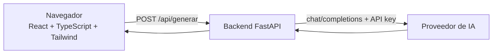

# Generador de preguntas con IA

Miniaplicación de una sola pantalla: pegas un texto y una IA genera preguntas de repaso.
Proyecto de la **Práctica UD1 · Explotación y despliegue de una aplicación con IA**.

> Estado: aplicación (backend + frontend) funcionando en local.
> Pendiente (fuera del alcance de este README por ahora): Clerk, Docker, Vercel y AWS.

## Arquitectura



- El **navegador** nunca habla con la IA: solo con nuestro backend.
- La **clave de la IA** vive solo en el servidor (variable de entorno).
- No hay base de datos ni historial: cada petición es independiente.

## Estructura del proyecto

```
.
├── api/
│   ├── index.py            # Backend FastAPI (endpoints, validación, llamada a la IA)
│   └── tests/test_api.py   # Tests del backend (sin llamadas reales a la IA)
├── frontend/
│   ├── index.html          # Página base de la SPA
│   ├── vite.config.ts      # Vite + Tailwind + proxy /api -> backend
│   └── src/
│       ├── main.tsx        # Punto de entrada de React
│       ├── App.tsx         # Única pantalla: formulario y resultado
│       ├── api.ts          # Llamada al backend y gestión de errores
│       └── index.css       # Activa Tailwind
├── .env.example            # Plantilla de variables (valores ficticios)
├── requirements.txt        # Dependencias del backend
├── requirements-dev.txt    # + pytest
└── pytest.ini              # Configuración de los tests
```

## API

| Método | Ruta | Descripción |
| --- | --- | --- |
| GET | `/api/health` | Devuelve `{"status": "ok"}`. Sirve para comprobar que el servicio vive. |
| POST | `/api/generar` | Recibe `{"texto": "...", "num_preguntas": 5}` y devuelve `{"preguntas": ["...", ...]}`. |

**Validaciones** (error `422` si no se cumplen): texto de 20 a 4000 caracteres y entre 1 y 10 preguntas.

**Errores controlados** (`{"detail": "mensaje"}`, sin exponer claves ni detalles internos):

| Código | Cuándo |
| --- | --- |
| 500 | Falta `AI_API_KEY` en el servidor |
| 502 | La IA falla, no responde o devuelve un formato inesperado |
| 504 | La IA tarda más de 25 segundos |

## Variables de entorno

| Variable | Finalidad | Tipo | Dónde se usa |
| --- | --- | --- | --- |
| `AI_API_KEY` | Clave de la API del proveedor de IA | **Secreta** | Backend, en ejecución |
| `AI_BASE_URL` | URL del proveedor (compatible con el formato OpenAI) | Pública | Backend, en ejecución |
| `AI_MODEL` | Modelo a utilizar | Pública | Backend, en ejecución |

## Puesta en marcha en local

Requisitos: Python 3.10+ y Node.js 18+.

### 1. Configurar la clave

```bash
cp .env.example .env
# Edita .env y pon tu AI_API_KEY real. El archivo .env NO se sube a Git.
```

### 2. Backend (terminal 1)

```bash
python -m venv .venv
source .venv/bin/activate          # En Windows: .venv\Scripts\activate
pip install -r requirements-dev.txt
cd api
uvicorn index:app --reload --port 8000
```

Comprueba que funciona abriendo <http://localhost:8000/api/health>.
La documentación automática de FastAPI está en <http://localhost:8000/docs>.

### 3. Frontend (terminal 2)

```bash
cd frontend
npm install
npm run dev
```

Abre la dirección que muestre Vite (normalmente <http://localhost:5173>).
Vite reenvía las peticiones `/api/...` al backend del puerto 8000.

## Tests

Desde la raíz del proyecto, con el entorno virtual activado:

```bash
pytest
```

Los tests **no llaman a la IA real** (se sustituye por una función falsa). Cubren:
health, entrada válida, entradas incorrectas (422) y errores del proveedor (502/504).

## Decisiones de diseño

- **Código simple**: un endpoint principal, una pantalla, sin base de datos.
- **Rutas relativas (`/api/...`)**: el frontend no necesita saber dónde está el backend,
  lo que facilita desplegarlo después en otros entornos.
- **Validación doble**: en el navegador (comodidad del usuario) y en el backend (seguridad).
- **Errores sin detalles internos**: el usuario ve mensajes claros; los detalles solo van al log.
