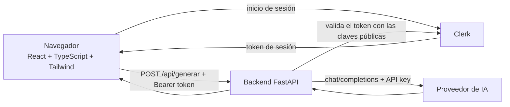

# Generador de preguntas con IA

Miniaplicación de una sola pantalla: pegas un texto y una IA genera preguntas de repaso.
Proyecto de la **Práctica UD1 · Explotación y despliegue de una aplicación con IA**.

> Estado: aplicación (backend + frontend) con inicio de sesión de Clerk, funcionando en local.
> Pendiente (fuera del alcance de este README por ahora): Docker, Vercel y AWS.

## Arquitectura



- El **navegador** nunca habla con la IA: solo con nuestro backend.
- La **clave de la IA** vive solo en el servidor (variable de entorno).
- **Clerk** gestiona el inicio y cierre de sesión. Nuestra aplicación no guarda usuarios ni contraseñas.
- El backend **valida el token de sesión** en cada petición a la IA. Sin token válido responde `401`.
- No hay base de datos ni historial: cada petición es independiente.

## Estructura del proyecto

```
.
├── api/
│   ├── index.py            # Backend FastAPI (endpoints, validación, llamada a la IA)
│   └── tests/test_api.py   # Tests del backend (sin llamadas reales a la IA)
├── frontend/
│   ├── index.html          # Página base de la SPA
│   ├── vite.config.ts      # Vite + Tailwind + proxy /api -> backend
│   └── src/
│       ├── main.tsx        # Punto de entrada de React
│       ├── App.tsx         # Única pantalla: formulario y resultado
│       ├── api.ts          # Llamada al backend y gestión de errores
│       └── index.css       # Activa Tailwind
├── .env.example            # Plantilla de variables (valores ficticios)
├── requirements.txt        # Dependencias del backend
├── requirements-dev.txt    # + pytest
└── pytest.ini              # Configuración de los tests
```

## API

| Método | Ruta | Descripción |
| --- | --- | --- |
| GET | `/api/health` | Devuelve `{"status": "ok"}`. Sirve para comprobar que el servicio vive. |
| POST | `/api/generar` | **Requiere sesión** (cabecera `Authorization: Bearer <token>`). Recibe `{"texto": "...", "num_preguntas": 5}` y devuelve `{"preguntas": ["...", ...]}`. |

**Validaciones** (error `422` si no se cumplen): texto de 20 a 4000 caracteres y entre 1 y 10 preguntas.

**Errores controlados** (`{"detail": "mensaje"}`, sin exponer claves ni detalles internos):

| Código | Cuándo |
| --- | --- |
| 401 | Falta el token, está caducado, la firma no es válida o viene de un origen no autorizado |
| 500 | Falta la clave de la IA o la configuración de Clerk en el servidor |
| 502 | La IA falla, no responde o devuelve un formato inesperado |
| 504 | La IA tarda más de 25 segundos |

## Variables de entorno

| Variable | Finalidad | Tipo | Dónde se usa |
| --- | --- | --- | --- |
| `AI_API_KEY` | Clave de la API del proveedor de IA | **Secreta** | Backend, en ejecución |
| `AI_BASE_URL` | URL del proveedor (compatible con el formato OpenAI) | Pública | Backend, en ejecución |
| `AI_MODEL` | Modelo a utilizar | Pública | Backend, en ejecución |
| `VITE_CLERK_PUBLISHABLE_KEY` | Clave pública de Clerk (`pk_test_...`) | Pública | Frontend, se incluye al compilar |
| `CLERK_JWKS_URL` | URL de las claves públicas de Clerk, para validar firmas | Pública | Backend, en ejecución |
| `CLERK_AUTHORIZED_PARTIES` | Orígenes permitidos, separados por comas | Pública | Backend, en ejecución |

Con este método de validación (claves públicas JWKS) el backend **no necesita la clave secreta de Clerk**
(`sk_test_...`), así que no hay que configurarla ni guardarla en ningún sitio.

## Configurar Clerk

Usa una instancia de **desarrollo** y cuentas de prueba.

1. En <https://clerk.com> crea una aplicación y activa un método de acceso sencillo (por ejemplo, email).
2. En el panel, abre **API Keys** y copia la **Publishable key** (`pk_test_...`) en `VITE_CLERK_PUBLISHABLE_KEY`.
3. En el mismo panel busca el **Frontend API URL** (algo como `https://nombre.clerk.accounts.dev`).
   Añade `/.well-known/jwks.json` al final y pon el resultado en `CLERK_JWKS_URL`.
4. En `CLERK_AUTHORIZED_PARTIES` pon el origen desde el que abres la aplicación, sin `/` final:
   - En local: `http://localhost:5173`
   - En Codespaces: la dirección del puerto 5173 (`https://...-5173.app.github.dev`).
   - Varios orígenes: sepáralos con comas.
5. Reinicia el backend y el frontend para que lean los cambios del `.env`.

### Cómo se valida el token en el backend

`api/index.py` comprueba, con PyJWT, que el token (1) está firmado por nuestra instancia de Clerk,
(2) no ha caducado, (3) lo ha emitido nuestra instancia (`iss`) y (4) procede de un origen autorizado (`azp`).
Si falta la configuración, el backend rechaza todas las peticiones en vez de dejarlas pasar.
Esto no depende de CORS: en desarrollo el frontend y el backend comparten origen gracias al proxy de Vite.

### Comprobación manual del rechazo sin token

```bash
curl -i -X POST http://localhost:8000/api/generar \
  -H "Content-Type: application/json" \
  -d '{"texto": "Texto de prueba con más de veinte caracteres."}'
# Debe responder: HTTP/1.1 401 Unauthorized
```

## Puesta en marcha en local

Requisitos: Python 3.10+ y Node.js 18+.

### 1. Configurar la clave

```bash
cp .env.example .env
# Edita .env y pon tu AI_API_KEY real. El archivo .env NO se sube a Git.
```

### 2. Backend (terminal 1)

```bash
python -m venv .venv
source .venv/bin/activate          # En Windows: .venv\Scripts\activate
pip install -r requirements-dev.txt
cd api
uvicorn index:app --reload --port 8000
```

Comprueba que funciona abriendo <http://localhost:8000/api/health>.
La documentación automática de FastAPI está en <http://localhost:8000/docs>.

### 3. Frontend (terminal 2)

```bash
cd frontend
npm install
npm run dev
```

Abre la dirección que muestre Vite (normalmente <http://localhost:5173>).
Vite reenvía las peticiones `/api/...` al backend del puerto 8000.

## Tests

Desde la raíz del proyecto, con el entorno virtual activado:

```bash
pytest
```

Los tests **no llaman a la IA real ni a Clerk** (la IA se sustituye por una función falsa y los
tokens se firman en el propio test con una clave de prueba). Cubren: health, entrada válida,
entradas incorrectas (422), errores del proveedor (502/504) y rechazo con 401 de peticiones sin token,
con token caducado, con firma falsa y con origen no autorizado (en todos ellos la IA no se consume).

## Decisiones de diseño

- **Código simple**: un endpoint principal, una pantalla, sin base de datos.
- **Rutas relativas (`/api/...`)**: el frontend no necesita saber dónde está el backend,
  lo que facilita desplegarlo después en otros entornos.
- **Validación doble**: en el navegador (comodidad del usuario) y en el backend (seguridad).
- **Autenticación delegada en Clerk**: sin base de datos ni gestión de usuarios propia.
- **Protección en el backend**: ocultar el formulario sin sesión es solo comodidad; lo que impide
  gastar la API de IA es la validación del token en FastAPI.
- **Errores sin detalles internos**: el usuario ve mensajes claros; los detalles solo van al log.
