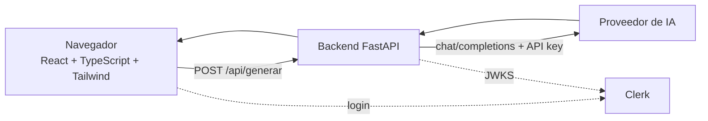

# Generador de preguntas con IA

Miniaplicación de una sola pantalla: pegas un texto y una IA genera preguntas de repaso. Proyecto de la **Práctica UD1 · Explotación y despliegue de una aplicación con IA**.

🔗 **Demo:** https://proyecto-explotacion-y-despliegue-d.vercel.app

## Características

- Generación de 1 a 10 preguntas de repaso a partir de un texto (20–4000 caracteres).
- Autenticación con **Clerk** (inicio y cierre de sesión).
- Backend que **valida el token de sesión** antes de consumir la IA.
- Sin base de datos ni historial: cada petición es independiente.
- Desplegable en **Vercel** y en **Docker**.

## Stack

| Capa | Tecnología |
|------|------------|
| Frontend | React, TypeScript, Vite, Tailwind CSS |
| Backend | Python, FastAPI, PyJWT |
| Autenticación | Clerk (validación por JWKS) |
| IA | Proveedor compatible con el formato OpenAI (`chat/completions`) |
| Tests | pytest |
| Despliegue | Vercel, Docker |

## Arquitectura



- El **navegador** nunca habla con la IA: solo con nuestro backend.
- La **clave de la IA** vive solo en el servidor (variable de entorno).
- **Clerk** gestiona el inicio y cierre de sesión. La aplicación no guarda usuarios ni contraseñas.
- El backend **valida el token** en cada petición a la IA. Sin token válido responde `401`.

## Estructura del proyecto

```
.
├── api/
│   ├── index.py            # Backend FastAPI (endpoints, validación, llamada a la IA)
│   └── tests/test_api.py   # Tests del backend (sin llamadas reales a la IA)
├── src/
│   ├── main.tsx            # Punto de entrada de React
│   ├── App.tsx             # Única pantalla: formulario y resultado
│   ├── api.ts              # Llamada al backend y gestión de errores
│   └── index.css           # Activa Tailwind
├── index.html              # Página base de la SPA
├── vite.config.ts          # Vite + Tailwind + proxy /api -> backend
├── vercel.json             # Configuración de despliegue en Vercel
├── Dockerfile              # Imagen para despliegue con Docker
├── .dockerignore
├── .env.example            # Plantilla de variables (valores ficticios)
├── package.json
├── tsconfig.json
├── requirements.txt        # Dependencias del backend
├── requirements-dev.txt    # + pytest
└── pytest.ini              # Configuración de los tests
```

## API

| Método | Ruta | Descripción |
|--------|------|-------------|
| GET | `/api/health` | Devuelve `{"status": "ok"}`. Comprueba que el servicio vive. |
| POST | `/api/generar` | **Requiere sesión** (`Authorization: Bearer <token>`). Recibe `{"texto": "...", "num_preguntas": 5}` y devuelve `{"preguntas": ["...", ...]}`. |

**Validaciones** (error `422`): texto de 20 a 4000 caracteres y entre 1 y 10 preguntas.

**Errores controlados** (`{"detail": "mensaje"}`, sin exponer claves ni detalles internos):

| Código | Cuándo |
|--------|--------|
| 401 | Falta el token, está caducado, la firma no es válida o viene de un origen no autorizado |
| 500 | Falta la clave de la IA o la configuración de Clerk en el servidor |
| 502 | La IA falla, no responde o devuelve un formato inesperado |
| 504 | La IA tarda más de 25 segundos |

## Variables de entorno

Copia `.env.example` a `.env` y rellena los valores. El archivo `.env` **no se sube a Git**.

| Variable | Finalidad | Tipo | Dónde se usa |
|----------|-----------|------|--------------|
| `AI_API_KEY` | Clave de la API del proveedor de IA | **Secreta** | Backend, en ejecución |
| `AI_BASE_URL` | URL del proveedor (formato OpenAI) | Pública | Backend, en ejecución |
| `AI_MODEL` | Modelo a utilizar | Pública | Backend, en ejecución |
| `VITE_CLERK_PUBLISHABLE_KEY` | Clave pública de Clerk (`pk_test_...`) | Pública | Frontend, al compilar |
| `CLERK_JWKS_URL` | URL de las claves públicas de Clerk | Pública | Backend, en ejecución |
| `CLERK_AUTHORIZED_PARTIES` | Orígenes permitidos, separados por comas | Pública | Backend, en ejecución |

Con la validación por JWKS el backend **no necesita la clave secreta de Clerk** (`sk_test_...`).

## Configurar Clerk

Usa una instancia de **desarrollo** y cuentas de prueba.

1. En [clerk.com](https://clerk.com) crea una aplicación y activa un método de acceso sencillo (por ejemplo, email).
2. En **API Keys**, copia la **Publishable key** (`pk_test_...`) en `VITE_CLERK_PUBLISHABLE_KEY`.
3. Copia el **Frontend API URL** (`https://nombre.clerk.accounts.dev`), añade `/.well-known/jwks.json` al final y ponlo en `CLERK_JWKS_URL`.
4. En `CLERK_AUTHORIZED_PARTIES` pon el origen desde el que abres la app, sin `/` final:
   - Local: `http://localhost:5173`
   - Producción: la URL de Vercel (o el dominio donde despliegues).
   - Varios orígenes: separados por comas.
5. Reinicia backend y frontend para que lean los cambios.

### Cómo se valida el token

`api/index.py` comprueba con PyJWT que el token (1) está firmado por nuestra instancia de Clerk, (2) no ha caducado, (3) lo emitió nuestra instancia (`iss`) y (4) procede de un origen autorizado (`azp`). Si falta la configuración, el backend rechaza todas las peticiones.

Comprobación manual del rechazo sin token:

```bash
curl -i -X POST http://localhost:8000/api/generar \
  -H "Content-Type: application/json" \
  -d '{"texto": "Texto de prueba con más de veinte caracteres."}'
# Debe responder: HTTP/1.1 401 Unauthorized
```

## Puesta en marcha en local

Requisitos: Python 3.10+ y Node.js 18+.

### 1. Configurar variables

```bash
cp .env.example .env
# Edita .env con tus valores reales
```

### 2. Backend (terminal 1)

```bash
python -m venv .venv
source .venv/bin/activate          # En Windows: .venv\Scripts\activate
pip install -r requirements-dev.txt
cd api
uvicorn index:app --reload --port 8000
```

- Health check: http://localhost:8000/api/health
- Documentación automática: http://localhost:8000/docs

### 3. Frontend (terminal 2)

```bash
npm install
npm run dev
```

Abre la dirección que muestre Vite (normalmente http://localhost:5173). Vite reenvía `/api/...` al backend del puerto 8000.

## Tests

Desde la raíz, con el entorno virtual activado:

```bash
pytest
```

Los tests **no llaman a la IA real ni a Clerk**: la IA se sustituye por una función falsa y los tokens se firman en el propio test con una clave de prueba. Cubren health, entrada válida, entradas incorrectas (422), errores del proveedor (502/504) y rechazo con 401 sin token, con token caducado, con firma falsa y con origen no autorizado.

## Despliegue

### Vercel

El frontend se sirve como SPA y el backend FastAPI desde `api/` (configuración en `vercel.json`).

1. Importa el repositorio en Vercel.
2. Añade las variables de entorno de la tabla anterior en **Settings → Environment Variables**.
3. Añade la URL de Vercel a `CLERK_AUTHORIZED_PARTIES`.
4. Despliega.

### Docker

```bash
docker build -t generador-preguntas .
docker run -d --env-file .env -p 80:8000 generador-preguntas
```

> Ajusta los puertos a los que exponga tu `Dockerfile`. Las variables `VITE_*` se incluyen al compilar la imagen, así que deben estar disponibles en el build.

En un servidor (por ejemplo AWS EC2) abre en el grupo de seguridad el puerto que publiques y añade el origen público a `CLERK_AUTHORIZED_PARTIES`.

## Decisiones de diseño

- **Código simple:** un endpoint principal, una pantalla, sin base de datos.
- **Rutas relativas (`/api/...`):** el frontend no necesita saber dónde está el backend, lo que facilita desplegar en distintos entornos.
- **Validación doble:** en el navegador (comodidad) y en el backend (seguridad).
- **Autenticación delegada en Clerk:** sin gestión de usuarios propia.
- **Protección en el backend:** ocultar el formulario sin sesión es solo comodidad; lo que evita gastar la API de IA es la validación del token en FastAPI.
- **Errores sin detalles internos:** el usuario ve mensajes claros; los detalles solo van al log.
